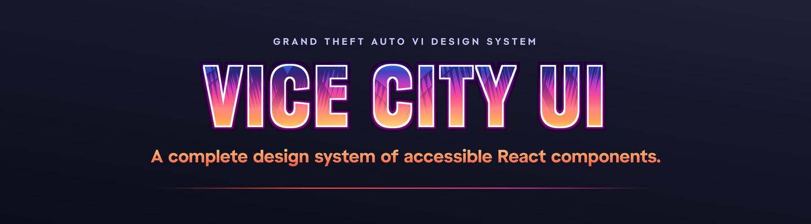

# Vice City UI

A complete design system styled after Grand Theft Auto VI, built with [Vercel UI SDK](https://ui-sdk.dev): game UI and everyday components for React.

Check it out here: [vice-city-ui.vercel.app](https://vice-city-ui.vercel.app)

Open any component for its live demo, keyboard map and source, or press ⌘K / Ctrl+K to search.

## Layout

- `src/leonida/` contains the game UI. Menus, phone, HUD, notifications, radio, weapons, and postcards each own their styles and implementation. Shared game tokens are in `src/leonida/shared/tokens.css`.
- `src/ui/` contains the core kit, grouped into forms, navigation, overlays, and display. `src/shared/` holds helpers used by both kits.
- `src/gallery/` defines live demos, examples, source links, and capture settings. `src/gallery/demo-sections.ts` sets the order in the catalogue.
- `src/site/` contains the catalogue, hash routing, search, playground, and source viewer. The development pages at `/harness.html` and `/preview.html` mount individual demos and sets.
- `tests/` groups behavior tests by site, core kit, and game UI. Run them with `bun run test`.
- `scripts/` contains the map and palm asset generators and `capture-previews.py` for refreshing catalogue images.

Set `data-motion="still"` on `<html>` to stop animations.
